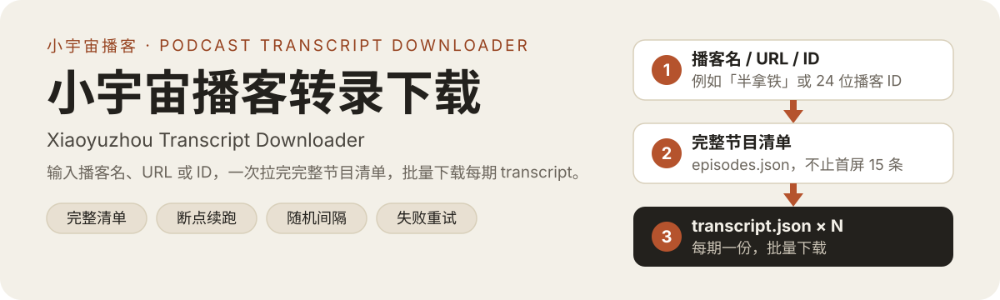

<p align="right"><a href="README.md">中文</a></p>

<p align="center">
  
</p>

<p align="center">
  <a href="https://xiaosang.cc/xiaoyuzhou-transcript-downloader/">▶ Try the UI Prototype</a>
  ·
  <a href="https://github.com/holynova/xiaoyuzhou-transcript-downloader">GitHub Repository</a>
</p>

Xiaoyuzhou Transcript Downloader batch-downloads a podcast's full episode list and every episode's transcript as JSON. Give it a podcast name, homepage URL, or 24-character podcast ID — it fetches the complete list (not just the 15 episodes on the web homepage) via [`opencli`](https://github.com/jackwener/opencli). Node 18+, zero npm dependencies, a single-file script. Random delays, retries, skip-existing, and resumable run state — an interrupted run picks up where it left off. A static UI prototype in the repo turns the CLI options into a visual workflow: configure parameters, generate the command, preview the output structure.

## Screenshot

<p align="center">
  
</p>

## Features

- **Three ways to pick a podcast**: name (e.g. 「半拿铁」), homepage URL, or 24-character podcast ID.
- **Complete episode list**: paginates with the Xiaoyuzhou API's `loadMoreKey`, so you get every episode — not just the 15 on the web homepage.
- **Batch transcripts**: downloads one `transcript.json` per episode via `opencli xiaoyuzhou transcript`.
- **Resumable**: `run-state.json` tracks success / skipped / failed, `failed.json` lists failures, existing files are skipped.
- **Gentle by default**: a random delay between episodes, 8–22 s by default (configurable); 2 retries per failed episode.
- **Partial runs**: `--start` / `--limit` downloads only part of the list — handy for testing or resuming.
- **Auth guidance**: on first run, if `~/.opencli/xiaoyuzhou.json` is missing, the script prompts you to paste a curl / headers / cookie export, extracts the tokens automatically, and writes the config file.
- **UI prototype**: `ui/index.html` turns the CLI options into a visual workflow — configure parameters, generate the command, preview the output tree. It does not run downloads itself.

## Quick Start

Requirements: Node.js 18+, [`opencli`](https://github.com/jackwener/opencli), and configured Xiaoyuzhou login credentials.

```bash
git clone https://github.com/holynova/xiaoyuzhou-transcript-downloader.git
cd xiaoyuzhou-transcript-downloader
node xiaoyuzhou-podcast-transcripts.mjs --help
```

Check your environment:

```bash
opencli --help
opencli doctor
opencli xiaoyuzhou --help
```

Interactive run (enter the podcast and confirm the download when prompted):

```bash
node xiaoyuzhou-podcast-transcripts.mjs
```

Search by podcast name and download all transcripts:

```bash
node xiaoyuzhou-podcast-transcripts.mjs --podcast "半拿铁" --download
```

By homepage URL or podcast ID:

```bash
node xiaoyuzhou-podcast-transcripts.mjs --podcast "https://www.xiaoyuzhoufm.com/podcast/62382c1103bea1ebfffa1c00" --download
node xiaoyuzhou-podcast-transcripts.mjs --podcast 62382c1103bea1ebfffa1c00 --download
```

Fetch the list only, without downloading transcripts:

```bash
node xiaoyuzhou-podcast-transcripts.mjs --podcast 62382c1103bea1ebfffa1c00 --yes
```

Slow the delay down, or download only 10 episodes (starting from episode 50):

```bash
node xiaoyuzhou-podcast-transcripts.mjs --podcast "半拿铁" --download --min-delay-ms 15000 --max-delay-ms 45000
node xiaoyuzhou-podcast-transcripts.mjs --podcast 62382c1103bea1ebfffa1c00 --download --start 50 --limit 10
```

## Auth

The script reads `~/.opencli/xiaoyuzhou.json`:

```json
{
  "access_token": "x-jike-access-token",
  "refresh_token": "x-jike-refresh-token",
  "device_id": "your-device-id",
  "device_properties": ""
}
```

`device_id` and `device_properties` are optional. If the file doesn't exist, the script guides you to paste a curl / headers / cookie export from your browser or a packet capture, extracts `x-jike-access-token`, `x-jike-refresh-token`, `x-jike-device-id`, and `x-jike-device-properties` automatically, and writes the file. **Never commit tokens to GitHub.**

## Output

Defaults to `./xiaoyuzhou-output/` (change with `--output`):

```
xiaoyuzhou-output/
  <podcast-name>-<podcast-id>/
    podcast.json          Podcast metadata
    episodes.json         Complete episode list
    run-state.json        Download status: success / skipped / failed
    failed.json           List of failed episodes
    transcripts/
      <episode-id>/
        transcript.json   One episode's transcript
```

## Options

```
--podcast <value>       Podcast name, homepage URL, or 24-character podcast ID (or a positional argument)
--download              Download all transcripts right after fetching the list
--yes                   Non-interactive confirmation; does not trigger downloads on its own — still needs --download
--output <dir>          Output root directory, default ./xiaoyuzhou-output
--min-delay-ms <n>      Lower bound of the download delay, default 8000
--max-delay-ms <n>      Upper bound of the download delay, default 22000
--retries <n>           Retries per failed episode, default 2
--start <n>             Start downloading from the nth episode, default 0
--limit <n>             Download at most n episodes, default 0 means all
```

## Tech

- Single-file CLI: `xiaoyuzhou-podcast-transcripts.mjs`, Node built-ins only (`node:child_process` / `fs` / `os` / `readline`), zero npm dependencies.
- The episode list paginates through the Xiaoyuzhou API's `loadMoreKey`; transcript downloads go through the `opencli xiaoyuzhou transcript` subcommand.
- UI prototype: a plain static trio under `ui/` (`index.html` / `app.js` / `styles.css`), no build — just open it; the root `index.html` redirects to `./ui/`.
- Some episodes simply have no transcript URL; the script records the failure and moves on.

```
xiaoyuzhou-podcast-transcripts.mjs   CLI main script: argument parsing / auth guidance / list pagination / batch downloads
ui/index.html                        UI prototype: parameter configuration, command generation, output preview
ui/app.js  ui/styles.css             UI prototype logic and styles
index.html                           Root page: redirects to ./ui/
package.json                         bin: xiaoyuzhou-transcripts; scripts: check / help
```

## License

MIT, see `LICENSE`. Only download content you have the right to access and use, and respect Xiaoyuzhou's terms and those of the podcast creators.
