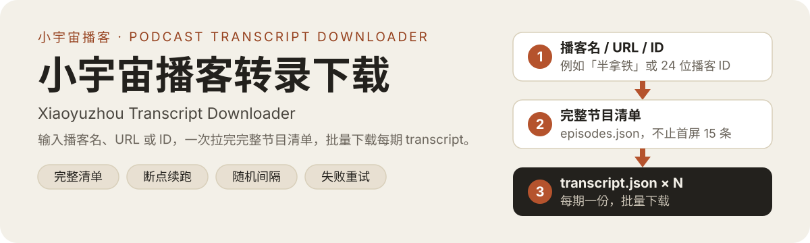

<p align="center">
  
</p>

<p align="center">
  <a href="https://xiaosang.cc/xiaoyuzhou-transcript-downloader/">▶ 在线体验 UI 原型 Try the UI Prototype</a>
  ·
  <a href="https://github.com/holynova/xiaoyuzhou-transcript-downloader">GitHub 仓库</a>
</p>

小宇宙播客转录批量下载器：输入播客名称、主页 URL 或 24 位播客 ID，一次拉完完整节目清单（不止网页首屏的 15 条），再批量下载每期 transcript，存成 JSON。基于 [`opencli`](https://github.com/jackwener/opencli)，Node 18+，零 npm 依赖，单文件脚本。随机等待、失败重试、跳过已存在文件、断点状态记录，跑一半断了也能续上。仓库内还有一个静态 UI 原型，可视化配置参数、生成命令、预览输出结构。

Xiaoyuzhou Transcript Downloader batch-downloads a podcast's full episode list and every episode's transcript as JSON. Give it a podcast name, homepage URL, or 24-character podcast ID — it fetches the complete list (not just the 15 episodes on the web homepage) via `opencli`. Node 18+, zero npm dependencies, a single-file script. Random delays, retries, skip-existing, and resumable run state. A static UI prototype in the repo turns the CLI options into a visual workflow.

## 截图 / Screenshot

<p align="center">
  
</p>

## 功能 / Features

- **三种输入**：播客名称（如「半拿铁」）、主页 URL、24 位播客 ID。
- **完整清单**：通过小宇宙 API 的 `loadMoreKey` 翻页，拉完所有节目，不止首屏 15 条。
- **批量下载 transcript**：逐期调用 `opencli xiaoyuzhou transcript`，每期存一份 `transcript.json`。
- **断点续跑**：`run-state.json` 记录成功 / 跳过 / 失败，`failed.json` 单独列失败节目；已存在的文件自动跳过。
- **温和限速**：每期之间随机等待，默认 8–22 秒，可调；单期失败默认重试 2 次。
- **分段下载**：`--start` / `--limit` 只下载一部分，适合测试或续跑。
- **认证引导**：首次运行若缺少 `~/.opencli/xiaoyuzhou.json`，脚本会提示粘贴 curl / headers / cookie，自动提取 token 并生成配置文件。
- **UI 原型**：`ui/index.html` 可视化配置参数、生成命令、预览输出结构；只负责组织工作流，不直接执行下载。

## 快速开始 / Quick Start

环境要求：Node.js 18+、[`opencli`](https://github.com/jackwener/opencli)、已配置小宇宙登录凭证。

```bash
git clone https://github.com/holynova/xiaoyuzhou-transcript-downloader.git
cd xiaoyuzhou-transcript-downloader
node xiaoyuzhou-podcast-transcripts.mjs --help
```

检查本机环境：

```bash
opencli --help
opencli doctor
opencli xiaoyuzhou --help
```

交互式运行（按提示输入播客、确认是否下载）：

```bash
node xiaoyuzhou-podcast-transcripts.mjs
```

按播客名搜索并下载全部 transcript：

```bash
node xiaoyuzhou-podcast-transcripts.mjs --podcast "半拿铁" --download
```

用主页 URL 或播客 ID：

```bash
node xiaoyuzhou-podcast-transcripts.mjs --podcast "https://www.xiaoyuzhoufm.com/podcast/62382c1103bea1ebfffa1c00" --download
node xiaoyuzhou-podcast-transcripts.mjs --podcast 62382c1103bea1ebfffa1c00 --download
```

只拉清单、不下载 transcript：

```bash
node xiaoyuzhou-podcast-transcripts.mjs --podcast 62382c1103bea1ebfffa1c00 --yes
```

调慢间隔、只下 10 期（从第 50 期开始）：

```bash
node xiaoyuzhou-podcast-transcripts.mjs --podcast "半拿铁" --download --min-delay-ms 15000 --max-delay-ms 45000
node xiaoyuzhou-podcast-transcripts.mjs --podcast 62382c1103bea1ebfffa1c00 --download --start 50 --limit 10
```

## 认证 / Auth

脚本读取 `~/.opencli/xiaoyuzhou.json`：

```json
{
  "access_token": "x-jike-access-token",
  "refresh_token": "x-jike-refresh-token",
  "device_id": "your-device-id",
  "device_properties": ""
}
```

`device_id` 与 `device_properties` 为可选字段。文件不存在时，脚本会引导你粘贴浏览器或抓包得到的 curl / headers / cookie，自动提取 `x-jike-access-token`、`x-jike-refresh-token`、`x-jike-device-id`、`x-jike-device-properties` 并写入该文件。**不要把 token 提交到 GitHub。**

## 输出 / Output

默认输出到 `./xiaoyuzhou-output/`（`--output` 可改）：

```
xiaoyuzhou-output/
  <播客名>-<播客ID>/
    podcast.json          播客基本信息
    episodes.json         完整节目清单
    run-state.json        下载状态：成功 / 跳过 / 失败
    failed.json           失败节目列表
    transcripts/
      <单期ID>/
        transcript.json   单期 transcript
```

## 选项 / Options

```
--podcast <value>       播客名称、主页 URL 或 24 位播客 ID（也可直接写位置参数）
--download              拉取清单后直接下载所有 transcript
--yes                   非交互确认；不会自动触发下载，仍需 --download
--output <dir>          输出根目录，默认 ./xiaoyuzhou-output
--min-delay-ms <n>      下载间隔下限，默认 8000
--max-delay-ms <n>      下载间隔上限，默认 22000
--retries <n>           单期失败重试次数，默认 2
--start <n>             从第 n 条开始下载，默认 0
--limit <n>             只下载 n 条，默认 0 表示全部
```

## 技术 / Tech

- 单文件 CLI：`xiaoyuzhou-podcast-transcripts.mjs`，只用 Node 内置模块（`node:child_process` / `fs` / `os` / `readline`），零 npm 依赖。
- 节目清单走小宇宙 API `loadMoreKey` 翻页；transcript 下载通过 `opencli xiaoyuzhou transcript` 子命令完成。
- UI 原型：`ui/` 下纯静态三件套（`index.html` / `app.js` / `styles.css`），无构建，直接打开即用；根目录 `index.html` 自动跳转到 `./ui/`。
- 某些节目本身没有 transcript URL，脚本会记录失败并继续处理其它节目。

```
xiaoyuzhou-podcast-transcripts.mjs   CLI 主脚本：参数解析 / 认证引导 / 清单翻页 / 批量下载
ui/index.html                        UI 原型：参数配置、命令生成、输出结构预览
ui/app.js  ui/styles.css             UI 原型的逻辑与样式
index.html                           根页：自动跳转到 ./ui/
package.json                         bin: xiaoyuzhou-transcripts；scripts: check / help
```

## English

**Xiaoyuzhou Transcript Downloader** batch-downloads a Xiaoyuzhou podcast's full episode list and every episode's transcript as JSON, powered by [`opencli`](https://github.com/jackwener/opencli).

- **Three ways to pick a podcast**: name (e.g. 「半拿铁」), homepage URL, or 24-character podcast ID.
- **Complete episode list**: paginates with the Xiaoyuzhou API's `loadMoreKey`, so you get every episode — not just the 15 on the web homepage.
- **Batch transcripts**: downloads one `transcript.json` per episode via `opencli xiaoyuzhou transcript`.
- **Resumable**: `run-state.json` tracks success / skipped / failed, `failed.json` lists failures, existing files are skipped.
- **Gentle by default**: random 8–22 s delay between episodes (configurable), 2 retries per episode, `--start` / `--limit` for partial runs.
- **Auth**: reads `~/.opencli/xiaoyuzhou.json`; on first run it guides you to paste a curl / headers / cookie export and extracts the tokens automatically. Never commit tokens to GitHub.
- **UI prototype**: `ui/index.html` turns the CLI options into a visual workflow — configure parameters, generate the command, preview the output tree. It does not run downloads itself.
- **Run it**: `node xiaoyuzhou-podcast-transcripts.mjs --podcast "半拿铁" --download`. Node 18+, zero npm dependencies, single-file script.

## 许可 / License

MIT，见 `LICENSE`。请只下载你有权访问和使用的内容，并遵守小宇宙及播客内容方的相关条款。
